# DarkFrame

**Aspect-ratio framing, film simulations and a cleaner shooting screen for the Sony α7R (ILCE-7R).**

DarkFrame is an unofficial PlayMemories Camera App for Sony cameras that still run the
in-camera Android platform. It masks the live view with black bands so you can compose in
another aspect ratio than the sensor's 3:2, then writes that crop (and an optional film look)
as XMP metadata next to each photo. Lightroom applies it on import: the photo arrives already
cropped, and you can always go back to the full 3:2 frame. No pixel is ever thrown away.

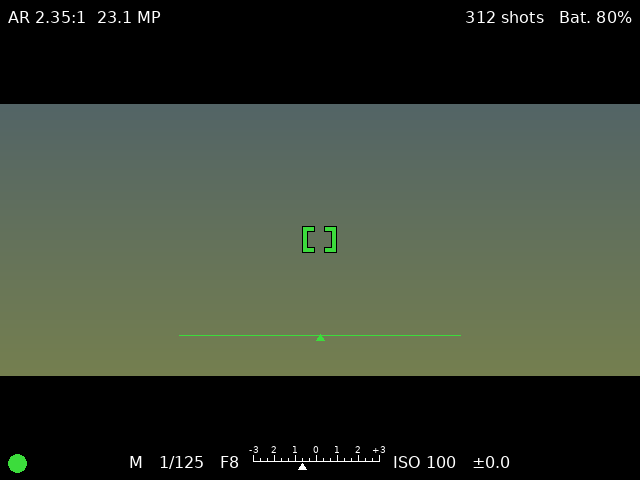

> ⚠️ **Experimental, use at your own risk.** DarkFrame is a hobby project, not made, tested
> or endorsed by Sony. It is installed with reverse-engineered tools and has only been tested
> on one α7R (ILCE-7R). RAW files are never modified.

## Features

- **Aspect-ratio bands:** 1:1, 7:6, 5:4, 4:3, 3:2, 16:9, 6x12, 2.35:1 and 65x24 (XPan-style),
  plus vertical formats 9:16, 2:3, 3:4, 4:5 and 6:7 (side bands, camera held level),
  with adjustable band opacity.
- **Non-destructive crop:** an `.xmp` sidecar next to each RAW (`DSC01234.xmp`), or an XMP
  block inserted into the file for JPEG-only shots (the image data is not re-encoded).
  Rapid sequences are queued so every photo keeps its own format.
- **Film simulations** (written to XMP for Lightroom, approximated in live view):
  Portra 400, Ektar 100, Gold 200, Pro 400H, Velvia 50, Provia 100F, Kodachrome 64,
  CineStill 800T, Tri-X 400 and HP5 Plus. Each look includes tone curve, colour, grain and
  vignette settings, plus `Format X` / `Film X` keywords.
- **Guides:** thirds, golden ratio, golden spiral (normal and flipped), centre cross.
- **Electronic level** with a thin horizon line.
- **One-line exposure readout:** shutter speed, aperture, exposure meter (±3 EV) and ISO,
  adjustable with the dials in M, A, S and P without leaving the app.
- **Status:** battery level, shots remaining, current format and film.
- **Focus brackets** in the centre, green when focus is confirmed.
- **Playback** that shows each photo with its own crop.

| Film menu | Level |
|---|---|
| 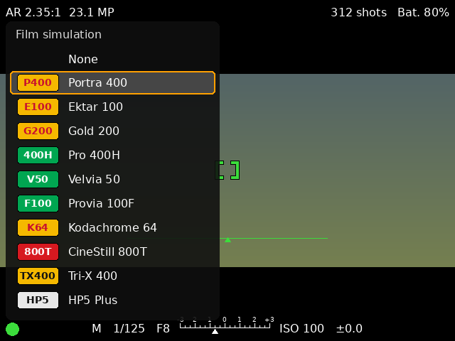 | 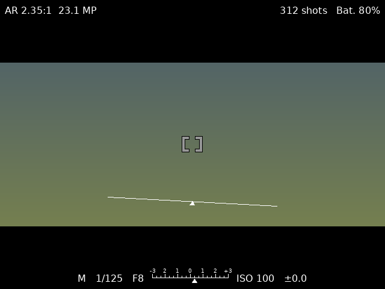 |

## Sample photos

Shot on a Sony α7R with DarkFrame on Réunion Island, framed in camera and cropped in Lightroom
from the XMP written by the app.

**2.35:1**

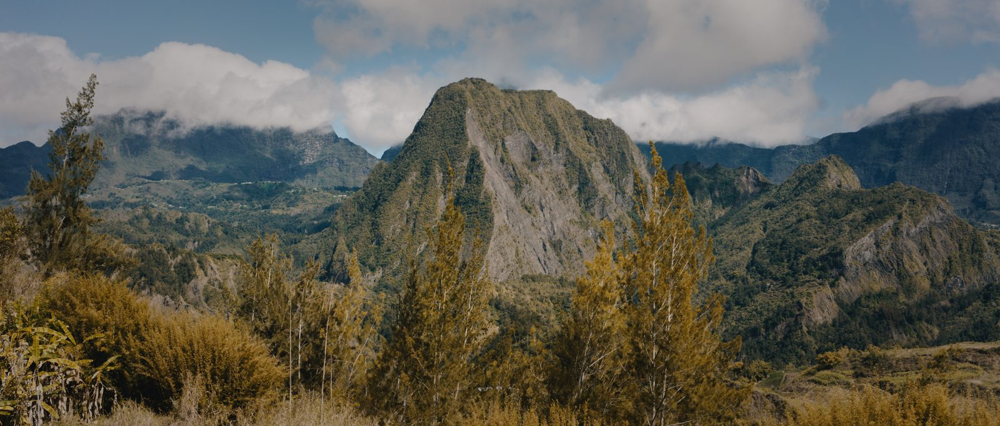

| | |
|---|---|
| 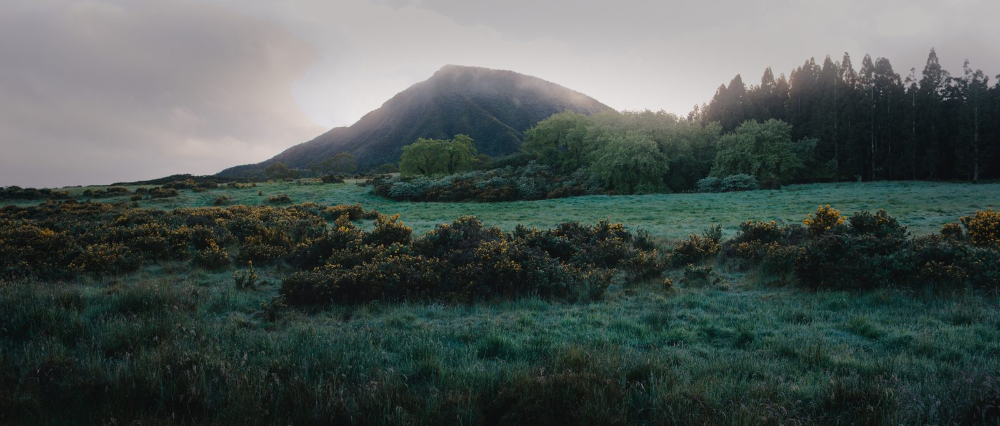 | 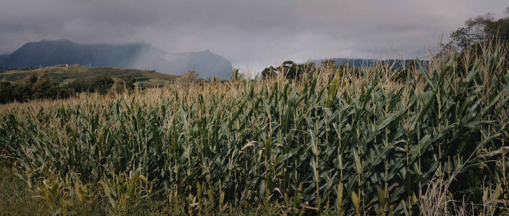 |
| 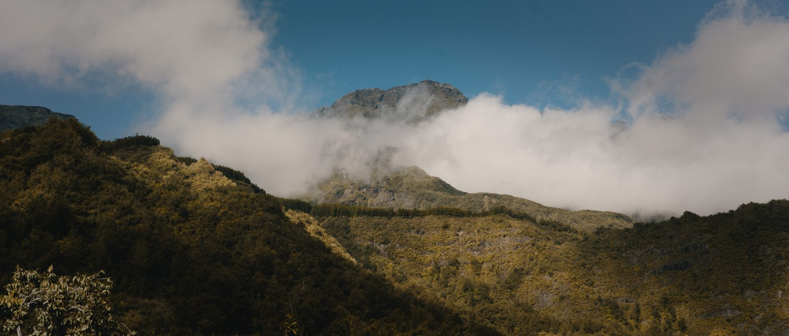 | 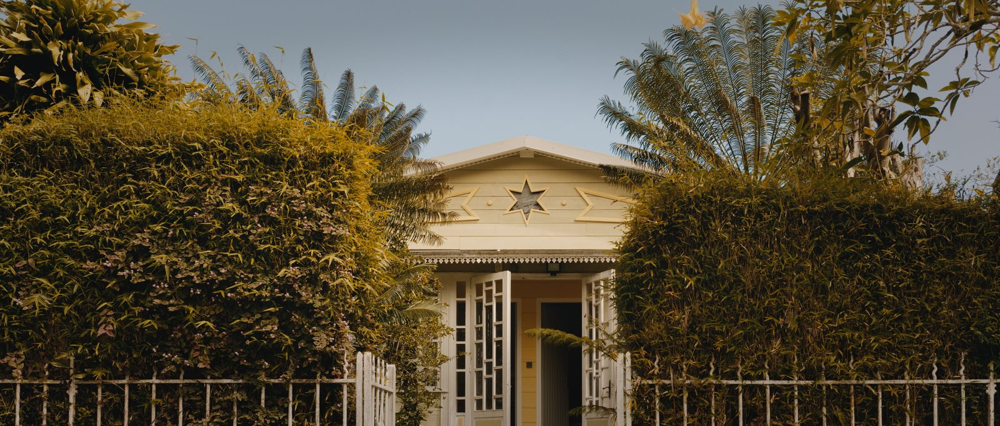 |
| 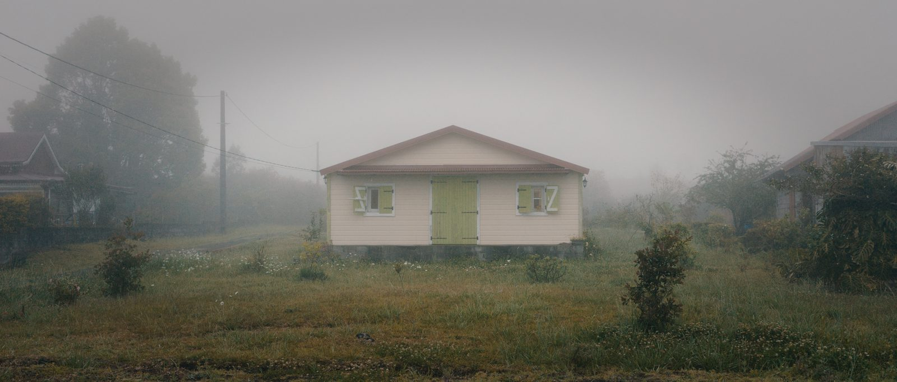 | 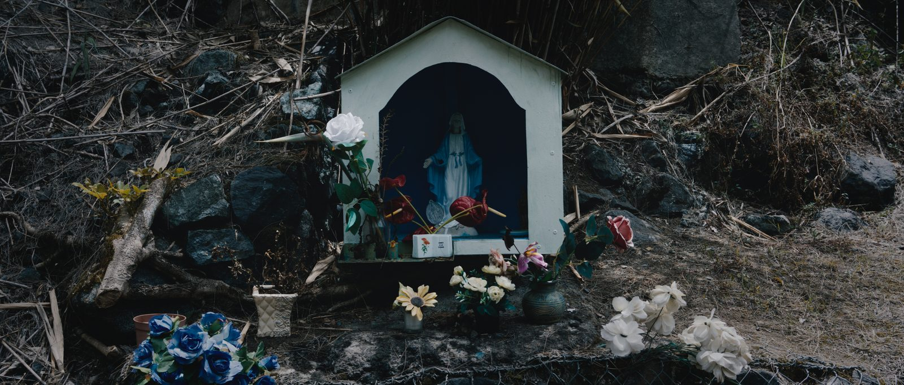 |
| 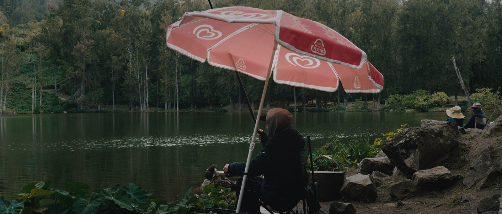 | |

**4:3, 7:6 and 1:1**

| 4:3 | 7:6 | 1:1 |
|---|---|---|
| 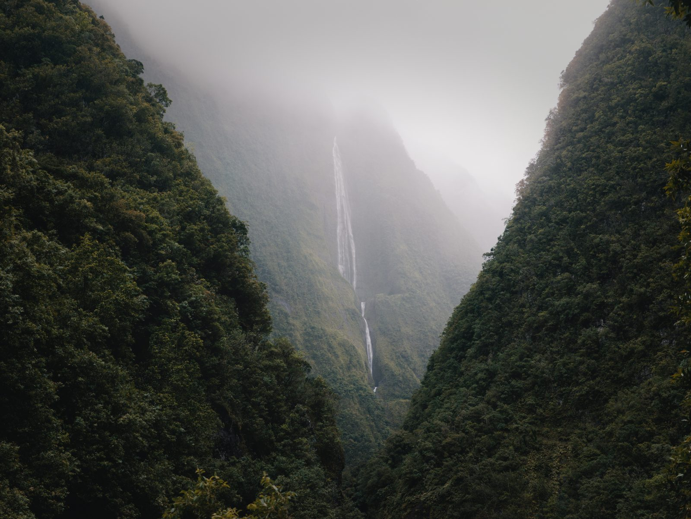 | 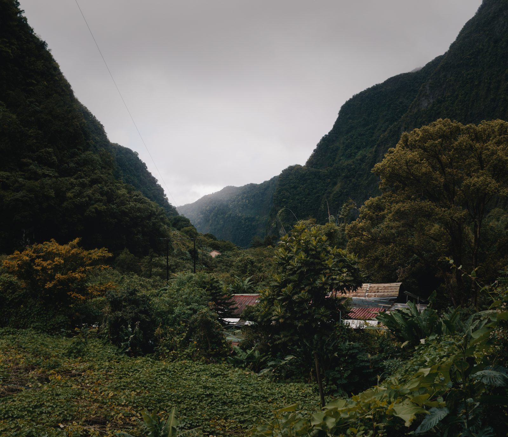 | 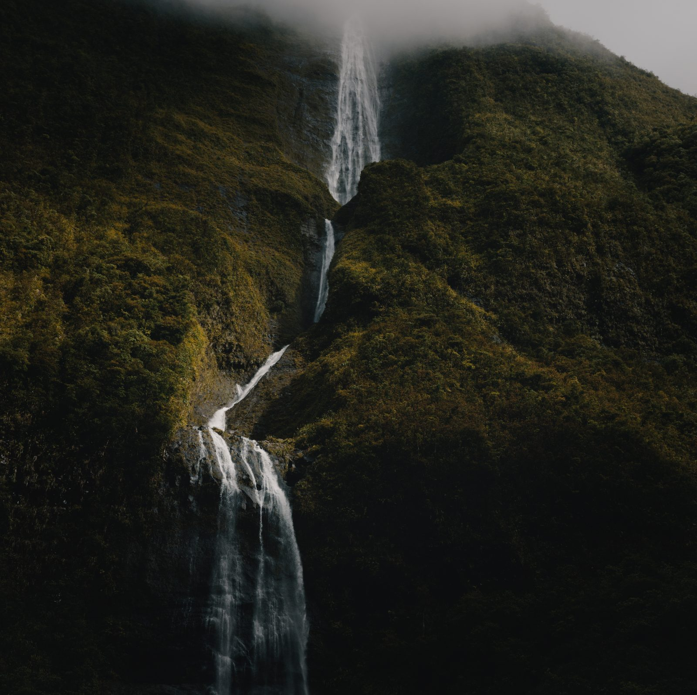 |
| 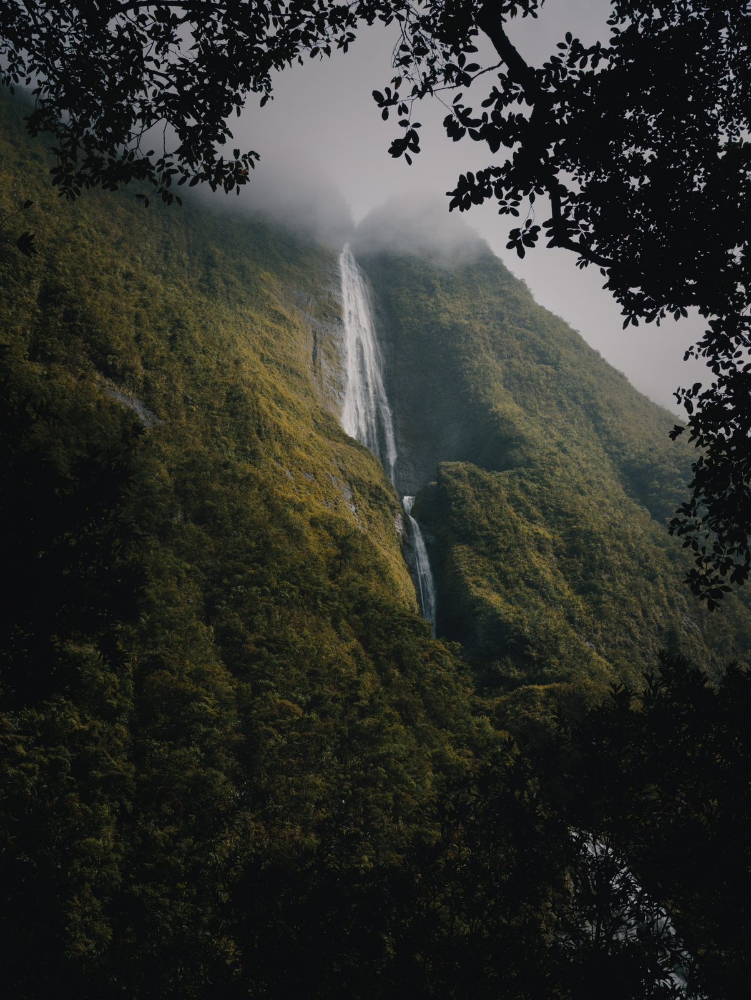 | 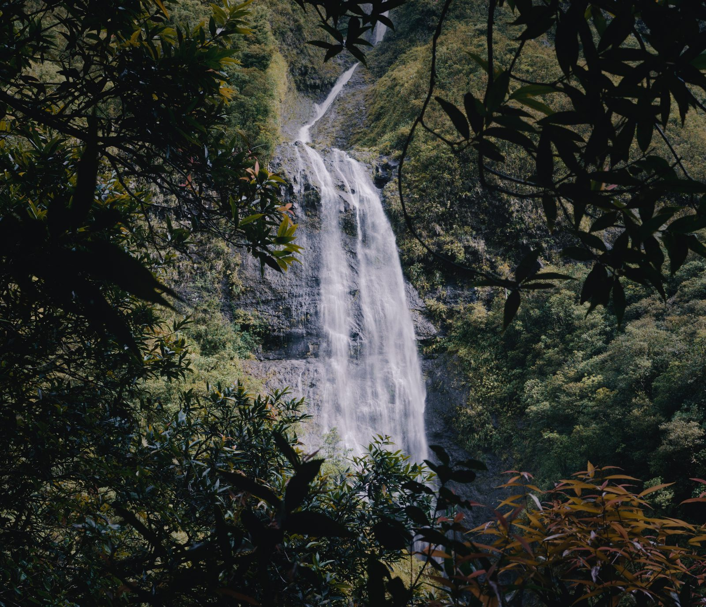 | 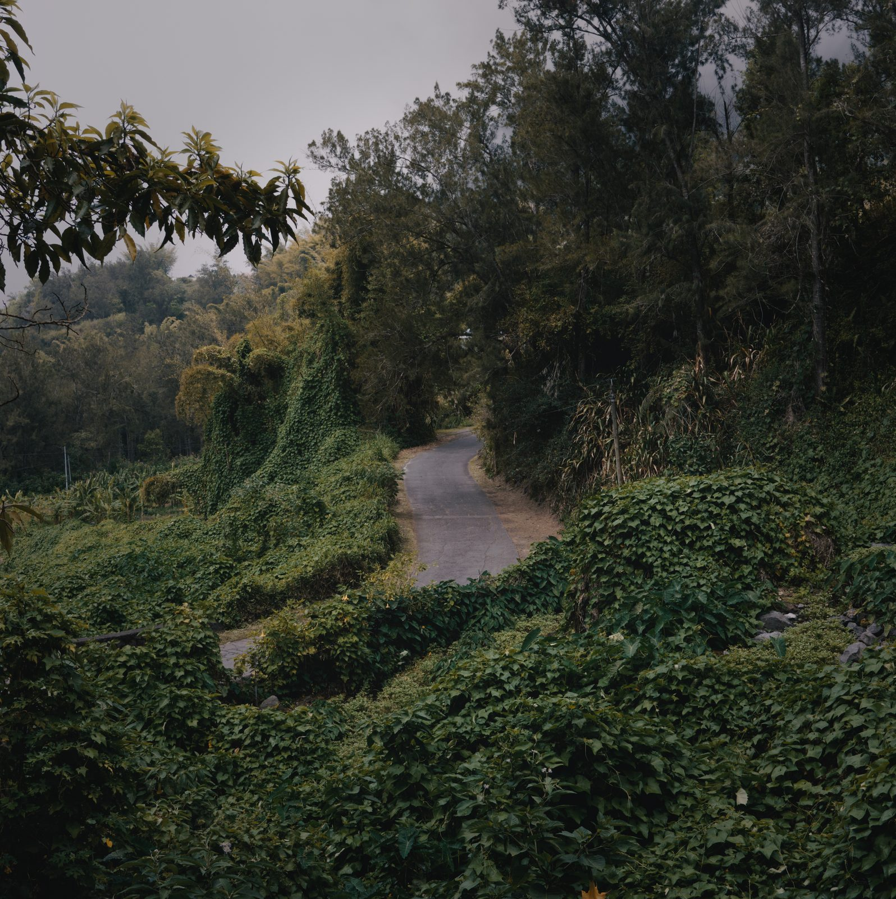 |

## Controls (α7R)

| Button | Action |
|---|---|
| **C2** | Next aspect ratio (cycles 9:16 → … → 1:1 → … → 65x24 → 9:16) |
| **Left / Right** | Previous / next aspect ratio |
| **Up / Down** | Band opacity |
| **Centre** | Hide / show the overlay |
| **C1** | Next guide (none, thirds, golden ratio, spirals, centre cross) |
| **Fn** | Open the film menu; press again (or Centre) to confirm |
| **Front dial** | Shutter speed (M and S) |
| **Rear dial** | Aperture (M and A) |
| **Control wheel** | ISO |
| **Exposure compensation dial** | Followed by the app (A, S, P) |
| **Playback** | Review photos with their crop |
| **Menu** | Opens the stock Sony menu |
| **Trash (C3)** | Quit the app |

On other cameras some keys may behave differently.

## Compatible cameras

DarkFrame only runs on cameras that supported **PlayMemories Camera Apps**.

- ✅ Tested: α7R (ILCE-7R)
- 🟡 Should work, untested: α7, α7S, α7 II, α7R II, α7S II, α6000, α6300, α6500, α5100,
  RX100 III–V, RX10 II/III…
- ❌ Not compatible: α7 III, α7R III, α9 and every later model (Sony removed the app platform).

See the [OpenMemories device list](https://openmemories.readthedocs.io/devices.html).

## Install

DarkFrame is installed with [Sony-PMCA-RE](https://github.com/ma1co/Sony-PMCA-RE) by ma1co.

1. On the camera: **MENU › Setup › USB Connection › Mass Storage**. Charge the battery fully.
2. Download `DarkFrame.apk` from the [Releases](../../releases) page (or build it, below).
3. Install Sony-PMCA-RE (macOS shown; Windows and Linux work too):

   ```sh
   mkdir -p ~/development && cd ~/development
   git clone https://github.com/ma1co/Sony-PMCA-RE.git
   cd Sony-PMCA-RE
   python3 -m venv venv
   ./venv/bin/pip install -r requirements.txt
   ```

4. Connect the camera over USB and install:

   ```sh
   cd ~/development/Sony-PMCA-RE
   killall -9 ptpcamerad            # macOS only: frees the USB connection
   sudo ./venv/bin/python -W ignore pmca-console.py install -f ~/development/DarkFrame.apk
   ```

5. Launch it from **MENU › Application › Application List › DarkFrame**.

To uninstall: **MENU › Application › Application Management › Delete**.

Diagnostics are written to `DARKFRAME/LOG.TXT` on the memory card.

## Lightroom

Import the RAW files together with their `.xmp` sidecars (they are picked up automatically).
The crop shows in the Crop tool and can be reset at any time. Sample XMPs are in
[`samples/`](samples/).

## Build

`build.sh` builds the APK without Android Studio or the Google SDK. It downloads the Android
API jars, the Jasmin assembler and [OpenMemories-Framework](https://github.com/ma1co/OpenMemories-Framework)
into `build/tools` on first run. On Ubuntu/Debian you need:

```sh
sudo apt-get install openjdk-17-jdk git curl unzip aapt dalvik-exchange apksigner zipalign
bash build.sh            # produces DarkFrame.apk, signed with tools/debug.keystore
```

Unit tests for the crop, film and XMP logic live in `app/src/test` and run on a plain JVM.

## Credits

- [OpenMemories-Framework](https://github.com/ma1co/OpenMemories-Framework) and
  [PMCADemo](https://github.com/ma1co/PMCADemo) by ma1co (MIT)
- [Sony-PMCA-RE](https://github.com/ma1co/Sony-PMCA-RE) by ma1co
- Dial handling inspired by BetterManual by Martin Tofall (MIT)

Sony, Alpha, PlayMemories, Lightroom, Kodak, Fujifilm, Ilford and CineStill are trademarks
of their respective owners. The film simulations are approximations made by eye and are not
affiliated with these brands.

## License

[MIT](LICENSE)
